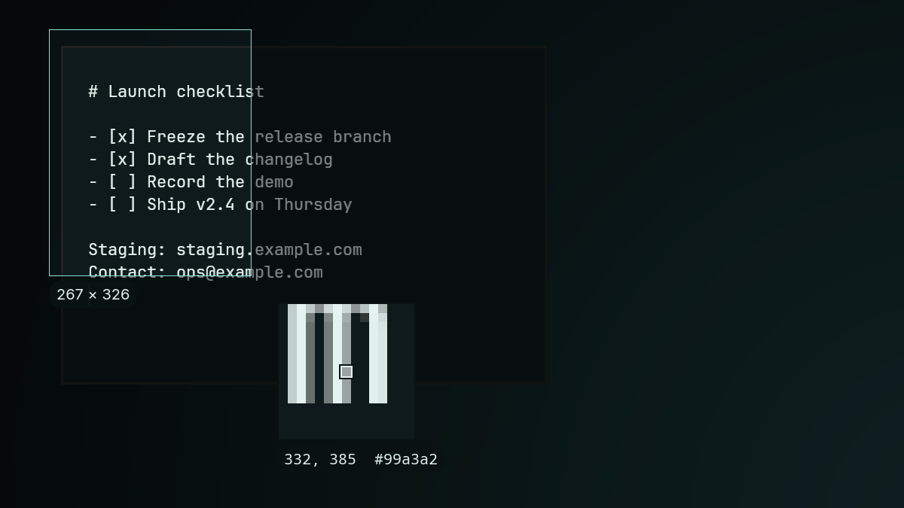
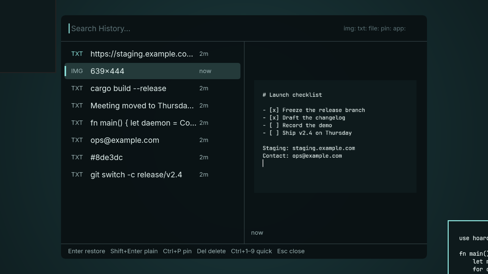

<div align="center">


# Hoarder

**Pixel-exact screenshots and clipboard history for Wayland.**

One Rust binary replaces seven tools, keeps every copy alive and never stores your passwords.

[](https://github.com/CPT-Dawn/Hoarder/releases/latest)
[](https://github.com/CPT-Dawn/Hoarder/actions/workflows/ci.yml)
[](https://aur.archlinux.org/packages/hoarder-bin)
[](LICENSE)

[Install](#install) · [Quick start](#quick-start) · [Documentation](docs/README.md) · [Contributing](CONTRIBUTING.md)




</div>

## Why Hoarder

- **Seven tools become one.** `hoarder shot`, `pick`, `copy`, `paste`, the Daemon and the Picker replace `grim`, `slurp`, `grimblast`/Hyprshot, `hyprpicker`, `wl-clipboard`, `wl-clip-persist` and `cliphist`.
- **Pixel-exact captures.** Every output freezes at its native buffer size and is never resampled, so shots stay sharp at fractional scaling and on 10-bit outputs.
- **Copies outlive their apps.** The Daemon takes over a copy only after the app that made it is gone. Pasting in Firefox, GTK apps and IntelliJ keeps working, unlike tools that re-offer every copy.
- **Passwords stay out of History.** Copies a password manager marks are never read. Tokens, keys and copies from KeePassXC, Bitwarden or 1Password live in locked memory for two minutes and never touch disk.
- **Fast on every change.** CI measures each commit: the Overlay shows in about 55 ms on a 4K output, and the Picker draws its first frame in under 30 ms with 1,000 Clips.
- **Drop-in for scripts.** `hoarder copy` and `hoarder paste` take every `wl-copy` and `wl-paste` flag, and `hoarder-wl-compat` swaps the commands themselves.

## Install

```sh
paru -S hoarder-bin
```

<details>
<summary>Other ways to install</summary>

**Arch Linux, replacing wl-clipboard**: `hoarder-wl-compat` provides `wl-copy` and `wl-paste` from Hoarder.

```sh
paru -S hoarder-bin hoarder-wl-compat
```

**Any distro**: download the `x86_64` or `aarch64` tarball from the [latest release](https://github.com/CPT-Dawn/Hoarder/releases/latest).

**From source** (needs Rust 1.97 or newer)

```sh
cargo install --locked --git https://github.com/CPT-Dawn/Hoarder --tag v1.0.4 hoarder
```

</details>

Hoarder runs on Hyprland, Sway 1.11+, niri, river, labwc, COSMIC and Wayfire. KDE Plasma gets the clipboard features only, and GNOME is not supported. See [Compatibility](docs/compatibility.md).

## Quick start

```sh
systemctl --user enable --now hoarder   # start the Daemon, now and at every login
hoarder setup hyprland --apply          # or sway, niri: write Hoarder's keybindings file
hoarder doctor                          # check everything; each problem comes with its fix
```

1. Add the one include line `setup --apply` prints to your compositor config and reload it. Hoarder never edits your main config.
2. Press <kbd>Print</kbd>, drag a Region and let go. The shot is on your clipboard as PNG and saved to `~/Pictures/Screenshots`.
3. Press <kbd>Super</kbd>+<kbd>V</kbd>, type to search and press <kbd>Enter</kbd>. The Clip pastes into the window you came from.

Every command explains itself with `hoarder <command> --help`.

## Documentation

| Guide | What it covers |
| --- | --- |
| [Keybindings](docs/keybindings.md) | Every key in the Overlay, Refine and the Picker |
| [Command line](docs/cli.md) | Shots, colours, `copy`/`paste`, History and pausing from a terminal |
| [Configuration](docs/config.md) | Every key in `config.toml`, its default and the themes |
| [Privacy](docs/privacy.md) | How each copy is classified, and what is stored where |
| [Troubleshooting](docs/troubleshooting.md) | `hoarder doctor`, and answers to common questions |
| [All docs](docs/README.md) | Installation, compatibility, agent setup, the socket API |
| [Changelog](CHANGELOG.md) | What changed in each release |

## Contributing

Hoarder v1.0 is finished and in maintenance mode: bug reports and app-compatibility reports help most. [CONTRIBUTING.md](CONTRIBUTING.md) has the setup, the checks CI runs and how the screenshots are made.

## License

[MIT](LICENSE) © Swastik Patel
